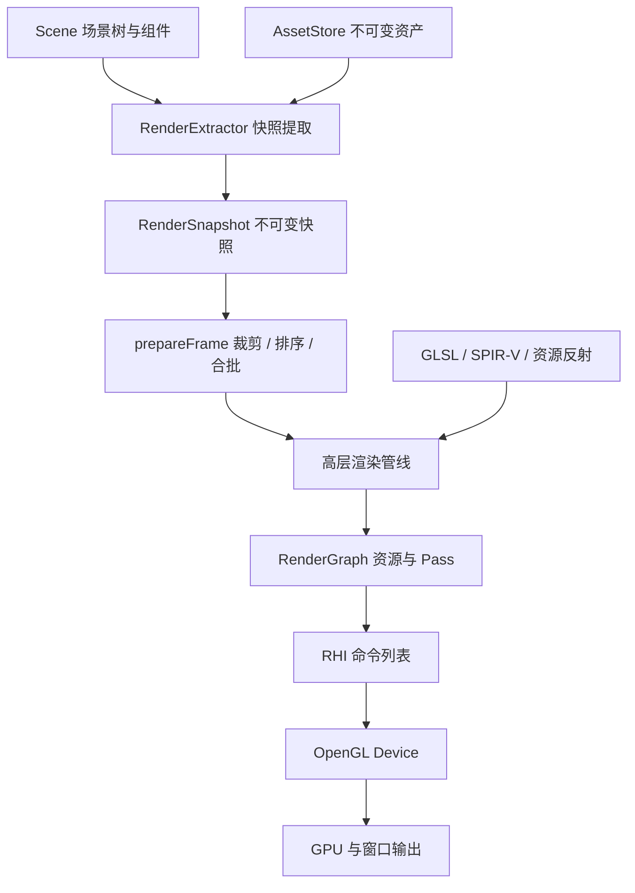

# 架构与扩展边界

[返回文档导航](README.md) · [接口说明](API_GUIDE.md)

## 分层与数据流

前端负责描述场景并生成与图形 API 无关的帧数据；RenderGraph 负责资源依赖与执行计划；RHI 后端负责设备操作。当前原生图形调用集中在 OpenGL RHI 实现，窗口层负责 GLFW。



`renderer::core` 包含场景、数学、资源、模型、Shader、快照、帧准备、RHI 接口和图编译。`renderer::opengl` 提供设备工厂、高层渲染后端及窗口。CPU 核心可以不链接 GLFW 或 OpenGL。

`renderer::animation` 和 `renderer::interaction` 是独立可选的扩展静态库，各自只依赖 core 公共接口；core/opengl 不反向链接扩展。交互模块通过共享不可变 PImpl 的 SpriteViewSnapshot 获取公开的视图几何、排序和纹理描述，不能读取私有快照结构。拾取筛选数据由 SceneQueryFilter 保存，渲染组件不保存 pickable。目录、安装和接入约定见[模块说明](MODULES.md)。

`renderer::audio` 同样是独立可选扩展，仅使用 core 的公共数学及句柄类型。miniaudio 隐藏在 PImpl 实现中，设备混音使用独立音频时钟，流式任务后台补页；应用线程负责控制、回收及取得结束事件。渲染、动画和音频之间通过应用传递位置及玩法事件，详见[音频说明](AUDIO.md)。

## PImpl 与所有权

所有对外服务类统一采用 PImpl：Scene、AssetStore、Model、RenderExtractor、RenderSnapshot、Renderer、Window、EventSubscription、ShaderCompiler、RHI Device/CommandEncoder/CommandList，以及 RenderGraph/CompiledRenderGraph/GraphResources。

独占服务通过 `unique_ptr<Impl>` 隐藏实现；可复制的只读快照、模型模板和命令列表使用 `shared_ptr<const Impl>`。析构及移动定义放在实现文件中，以便公共头文件仅前置声明 Impl。

数学类型、描述结构和句柄是值类型，不套 PImpl。内部实现允许普通结构或虚接口，不要求额外封装。公共头文件不包含 OpenGL、GLFW、glslang 或 SPIRV-Cross 实现类型。PImpl 隔离实现依赖，但公共接口仍使用 C++ 标准库类型，不承诺跨编译器二进制兼容。

| 对象 | 拥有/保存的数据 | 生命周期要点 |
| --- | --- | --- |
| Scene | 节点拓扑、局部/世界变换、组件 | 组件引用资产句柄，不拥有仓库 |
| AssetStore | 不可变网格、纹理、材质 | 句柄删除与数据释放分离，材质保留纹理引用 |
| Model | 模板节点、组件与资产句柄 | 实例节点独立，资产由仓库管理 |
| RenderSnapshot | 解析后的资产引用、世界数据、相机和灯光 | 不依赖原场景/仓库存活 |
| Renderer | 渲染队列、帧槽、GPU 缓存、图 | 析构时排空任务并完成设备清理 |
| AudioClip / AudioEngine | 共享 PCM 或流式文件描述 / 设备、播放实例和混音组 | 实例保留资源；控制在创建线程，设备停止后安全释放实例及后台任务 |
| CompiledRenderGraph | 编译计划、回调、分配的 RHI 资源、共享设备状态 | 绑定首次执行的设备，清理在设备线程进行 |

句柄由类型标签、owner、index、generation 组成。owner 隔离仓库或设备，generation 防止释放槽位复用后误用旧句柄；非空句柄不代表当前有效。

## 场景更新与快照

场景树使用父节点及双向兄弟链保存拓扑。拓扑变化时迭代重建父节点在前的遍历序列，普通变换修改不重建拓扑。

每个节点记录本地变换版本、上次应用的版本及父世界版本。更新时仅在本地版本或父世界版本改变后重新计算世界矩阵，并更新继承可见性。这仍需遍历节点检查版本，并不是完全跳过未修改的子树。子树删除和遍历都避免递归深度限制。

提取器在应用线程解析资产句柄，复制世界变换/相机/灯光，建立独立的不可变快照。法线逆转置矩阵及世界 AABB 根据节点完整句柄、网格身份和世界版本缓存。切换场景清空缓存，消失节点的缓存会被清理；不可逆变换的网格实例跳过提取。

## 视图准备与合批

精灵快照额外保留不可变 Sprite 资源、逻辑世界矩阵、表现组件和最外层排序组。资源共享四边形及按纹理/Alpha/unlit 缓存的材质。每个视图在 `src/sprite.cpp` 展开 Billboard 几何、UV 与裁剪偏移，随后进行实际 AABB 裁剪；不会回写 Scene。GPU 实例新增 UV 矩形与线性 tint，网格默认使用完整 UV 和白色。

Blend 精灵按层、顺序、落地点深度、稳定分组身份及部件顺序排序。SortedAlpha 模式与普通透明网格混排；OIT 模式把默认精灵放入合成后的可选 `Ordered Sprites` Pass，FollowView 精灵才进入 OIT 累积。图缓存键包含是否需要该 Pass。实现细节和限制见 [Sprite 说明](SPRITES.md)。

`src/frame_builder.cpp` 中的 `prepareFrame()` 选择相机，构建最多 64 个灯光，按层掩码和六个零到一裁剪平面测试世界 AABB。

不透明 submesh 按材质、网格、submesh、镜像绕序排序并合批。负行列式变换使用对应的绕序 Pipeline；默认 SortedAlpha 的透明项按相机空间深度稳定地从远到近排序，只合并相邻兼容项。可选 WeightedBlendedOIT 不要求深度提交顺序，按相同状态键聚类以合并实例。

阴影投影者独立于相机视锥收集，同时遵守继承可见性、层掩码、castShadow 和 Alpha 模式。它们的世界包围盒用于拟合主方向光的正交投影，光空间投影中心按阴影纹素对齐。当前为单张方向光阴影图，没有级联阴影或点/聚光灯阴影。

## Shader 和绑定 ABI

glslang 将 Vulkan 语义的 GLSL 450 编译为 SPIR-V 1.5；SPIRV-Cross 提供块大小/成员偏移反射，并将同一产物转译为桌面 GLSL 450。此流程不创建设备，也不依赖 Vulkan SDK。

RHI Pipeline 按逻辑 `(group,binding)` 合并阶段反射并验证兼容性，然后在 UBO、SSBO、采样纹理、Storage Image 四类 OpenGL 命名空间中分别紧凑分配绑定点。逻辑组号不直接等于 OpenGL 物理绑定点。

Vulkan 后端直接创建 SPIR-V ShaderModule，并将同一反射结果映射为 DescriptorSetLayout / PipelineLayout。两种后端共同使用 `src/backends/common/renderer_backend.cpp` 的帧流程，窗口平台位于 `src/platform`，原生设备实现分别位于 `src/backends/opengl` 和 `src/backends/vulkan`。Vulkan 的资源保活、范围屏障与交换链同步见 [Vulkan 专章](VULKAN.md)。

内置着色器约定如下，定义位于 `src/backends/common/portable_shaders.hpp`：

| 逻辑组 | 绑定 | 内容 |
| --- | --- | --- |
| 0 | 0 / 1 / 2 | 帧 UBO / 灯光 SSBO / 阴影采样纹理 |
| 1 | 0 | 材质 UBO |
| 1 | 1–5 | 基色 / 法线 / 金属度粗糙度 / AO / 自发光纹理 |
| 2 | 0 | HDR 后处理输入 |

CPU 的 FrameUniforms、LightGpu 和 MaterialGpu 见 `src/internal/frame.hpp`。修改布局必须同步检查反射、CPU 偏移与块大小；实例数据还需与顶点属性布局一致。运行时验证 Buffer 最小范围和设备对齐。

ShaderCompiler 以预处理源码及阶段缓存产物，宏和 include 内容参与键。RHI 共享相同 SPIR-V 阶段所链接的程序；Renderer 初始化预热不透明、透明、双面、镜像和阴影变体，光栅状态固定在 Pipeline 中。

## RenderGraph 编译与执行

`src/render_graph.cpp` 分为五个分析步骤：

1. 按声明的生产顺序验证 mip/字节区间初始化，建立重叠的 RAW（写后读）、WAR（读后写）、WAW（写后写）依赖；合并显式依赖。
2. 从导出资源的写入者与副作用 Pass 反向保留依赖闭包，剔除无关分支。
3. 对保留的 Pass 稳定拓扑排序，发现环时拒绝编译。
4. 按最终顺序生成带资源身份、范围、阶段和访问类型的屏障，计算首次/末次使用点。
5. 为描述兼容、生命周期严格不重叠的临时资源安排物理复用；导出资源存活到图末尾。

访问范围非法、未初始化读取、同 Pass 重叠读写或附件反馈会被拒绝；需要存储读改写时使用单条 `StorageReadWrite` 声明。图只验证声明，不推断回调中命令的访问，外部可变资源必须导入并正确建模。

首次执行创建物理资源，后续执行复用分配。逻辑资源共享物理存储时插入完整依赖。GraphResources 的解析权限每个 Pass 重新设置，只允许访问当前声明的资源。

编译图保存共享设备后端而不是 Device 包装对象地址，允许 Device 移动，但不能切换到另一设备。回调捕获对象的生命周期由调用者负责；设备资源分配、执行和清理在上下文线程完成。

## 内置渲染链路

```text
Shadow -> Opaque PBR -> Transparent -> ToneMap -> Present
```

开启 `RenderView.transparency = WeightedBlendedOIT` 后，Transparent 替换为 `OIT Accumulation -> OIT Resolve`。RGBA32F 累积加权预乘颜色，R32F 累积剩余透过率；两个附件采用独立混合状态，Resolve 加载并混合到原 HDR，再统一 ToneMap。默认排序模式不分配 OIT 目标，模式改变会重建渲染图。算法和成本见 [OIT 说明](OIT.md)。

开启 `RenderView.antiAliasing = AntiAliasing::FXAA` 时，在 ToneMap 与 Present 之间增加 FXAA。ToneMap 先向普通 RGBA8 临时纹理写入显示编码颜色，FXAA 在此感知空间检测边缘并过滤，再解码为线性值写最终 sRGB 附件。关闭时不创建该目标或 Pass，图缓存键包含抗锯齿模式，详见 [FXAA 说明](ANTI_ALIASING.md)。

| 阶段 | 主要行为 |
| --- | --- |
| Shadow | 方向光 Depth32F，Alpha Mask 裁剪，光栅深度偏移 |
| Opaque PBR | 清除并写入 RGBA16F HDR 和 Depth32F 场景深度 |
| Transparent | 加载 HDR/深度，深度测试开启、深度写入关闭，线性混合 |
| ToneMap | 曝光及 None/ACES/Reinhard；关闭 FXAA 写 sRGB 显示目标，开启时写显示编码的普通 RGBA8 中间目标 |
| FXAA（可选） | 感知空间边缘检测、端点搜索和亚像素重采样，写入最终 sRGB 目标 |
| Present | 将显示纹理拷贝到窗口默认帧缓冲，交换缓冲由 Renderer::present() 完成 |

主方向光阴影结合光栅偏移、接收平面深度梯度修正和 3×3 PCF，防止 PCF 邻域偏移在斜面上产生自阴影条纹。GPU 测试比较同一视图的无遮挡接收面在开/关阴影时的输出，覆盖此问题。

关闭阴影时仍保留图阶段，使用最小阴影目标且没有阴影批次。图在窗口尺寸、实际阴影目标尺寸、透明或抗锯齿模式改变时重建，其余帧复用。

数学约定统一为右手系、列向量、列主序、NDC 深度 [0,1]，默认 LESS、清除深度 1；OpenGL 设置对应的 clip control。颜色纹理先 sRGB 解码，HDR 内线性光照与混合，输出到 sRGB 附件时编码，呈现拷贝避免二次编码。

## RHI、同步与回收

CommandEncoder 只录制 CPU 命令，各工作线程可独立录制；Device 所在线程验证并回放。图形/计算 Pipeline、绑定组、直接/间接绘制、dispatch、拷贝、屏障、时间戳和呈现拷贝均通过 RHI。GraphicsPipelineDesc 可用 colorBlends 指定逐附件混合因子，非空时必须与颜色附件等长；为空时兼容原有 BlendMode，绑定 Pipeline 时覆盖活动附件状态以避免模式切换泄漏。

OpenGL 对着色器存储访问使用与后续用途对应的 memory barrier 位，同时处理存储写前的 WAR 依赖。常规附件与传输依赖使用相应 OpenGL 操作的顺序保证。RHI 屏障仍保留完整资源与范围语义，为未来后端使用。

每次提交插入 Fence 并返回单调完成序号。销毁使句柄立即失效，原生对象在最后引用它的提交完成后释放；清理 VAO/FBO 引用避免驱动意外保留缓冲或纹理。纹理视图引用共享底层存储，独立句柄销毁不提前释放仍使用的存储。

每个 Renderer 帧槽都有独立的持久/coherent 映射帧、灯光和实例上传 Buffer，复用或扩容前等待本槽完成。coherent 只解决可见性，不允许 CPU 覆写 GPU 尚在读取的内容。GPU 网格/纹理/材质按不可变资源身份缓存，CPU 资源所有者消失后进入回收。

时间戳从已完成槽位读取，避免为了本帧统计强制等待 GPU。RenderStats 中的 GPU 数据可能滞后，使用前检查 gpuTimingValid。

## 线程与上下文生命周期

Window 拥有事件分发器，WindowState 只保留它的弱引用。原生回调立即更新必要的内部尺寸缓存，并将拥有数据副本的事件入队；主线程 pollEvents 再按注册顺序调用订阅者。PImpl EventSubscription 仅弱引用订阅槽并通过原子标记取消，不延长窗口生命周期；Window 销毁时即关闭分发器，Renderer 保留原生窗口也不会保留应用回调。每批使用固定订阅快照，用户异常在完成本批后重抛，详见[窗口事件说明](WINDOW_EVENTS.md)。

窗口事件、缩放和 framebuffer 尺寸查询留在应用主线程。开启 `RendererConfig.renderThread` 时先在主线程解绑上下文，再通过启动握手交给专用线程；启动错误经 future 回传。

渲染任务进入有界队列，队列满时提交者等待。`submit()` 持有快照并返回 future，`render()` 等价于 submit 后 get。呈现、回读、idle 操作按同一队列路由，任务异常由 packaged_task 交给 future。

析构时先停止接收任务，排空已有任务，在工作线程销毁 GPU 后端并解绑上下文；Impl 额外保留窗口引用，使窗口最后释放仍发生在应用线程。调用者应在窗口创建线程销毁 Renderer，并使用 Renderer::present() 进行线程路由。

## 扩展方式与当前边界

| 修改目标 | 通常涉及的位置与约束 |
| --- | --- |
| 新增场景组件 | scene.hpp、Scene::Impl、组件派发与快照提取；保持单写和版本管理 |
| 新增材质参数 | MaterialDesc、资源解析、MaterialGpu、反射 ABI、Shader 与 GPU 验证 |
| 新增渲染阶段 | 高层图构建；声明全部访问、输出或副作用，避免捕获已失效对象 |
| 新增 RHI 能力 | 公共描述、命令记录、内部 DeviceBackend、OpenGL 校验和回放 |
| 新增模型能力 | 导入器校验与事务、静态模型数据、对应 CPU 测试资产 |
| 新增后端 | 内部 DeviceBackend、设备工厂、平台表面/上下文与高层后端创建入口 |

静态导入支持 glTF/GLB 和 OBJ/MTL。glTF 支持交错、归一化、稀疏 accessor，triangle/strip/fan、节点矩阵/TRS、透视/正交相机，以及 unlit、emissive-strength、punctual-light 扩展。OBJ 支持负索引、凹多边形耳切三角化和基础 MTL。动画、蒙皮、morph、压缩几何、非 TEXCOORD_0、纹理变换和高级 MTL 贴图选项不在当前范围，会明确报告；部分无限范围相机/灯光使用有限近似。

Vulkan 后端已经实现，复用 Scene、Model、快照、帧准备、图编译、SPIR-V 和逻辑描述符组。两个后端共享 common 下的高层管线与内置 Shader；平台库共用窗口事件和全屏。Vulkan 使用动态渲染、描述符组、fence 和 synchronization2，具有独立表面/交换链和设备工厂。窗口创建时指定 GraphicsApi，后续渲染数据保持一致；具体能力、内存/布局策略及当前限制见 [Vulkan 说明](VULKAN.md)。
