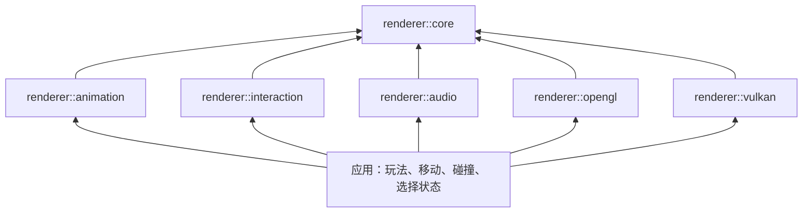

# 模块划分与按需接入

[文档导航](README.md) · [SDK 安装](SDK.md) · [Sprite 开发](SPRITES.md)

动画、交互和音频分别生成独立的可选静态库。核心和两种图形后端不链接这些扩展；应用按需要选择组件。

Visual Studio 解决方案中，`renderer_core`、启用的 `renderer_opengl` / `renderer_vulkan`、共用的 `renderer_platform` / `renderer_pipeline` 及 GLAD/Volk 实现目标归入 `core` 文件夹；动画、交互、音频及音频内部实现目标归入 `modules` 文件夹。示例和测试继续分别位于 `examples`、`tests`；这些逻辑分组不改变库的依赖关系、输出位置或 SDK 安装路径。

| CMake 目标 | 职责 | 直接依赖 | 默认构建 |
| --- | --- | --- | --- |
| `renderer::core` | 数学、资源、场景、快照、Sprite/图集、Billboard、排序、帧准备、Shader、RHI/RenderGraph 接口 | 现有 CPU 工具链依赖 | 是 |
| `renderer::opengl` | OpenGL 4.5 设备与渲染器工厂 | core、共用平台/管线、GLAD | 是 |
| `renderer::vulkan` | Vulkan 1.3 设备、交换链与渲染器工厂 | core、共用平台/管线、私有 Volk 对象 | 否，显式开启 |
| `renderer::animation` | 序列帧、方向选择、播放状态、动画事件、更新精灵组件 | core | 是，可关闭 |
| `renderer::interaction` | 屏幕射线、地面求交、Alpha 拾取、交互筛选 | core | 是，可关闭 |
| `renderer::audio` | 音乐流、音效实例、混音分组、空间定位、播放事件 | core、私有 miniaudio 实现 | 是，可关闭 |



`renderer_platform` 封装共用 GLFW 窗口，`renderer_pipeline` 执行共用的 RHI 渲染流程；它们是内部静态依赖，SDK 自动传递，应用不直接链接。两种后端可以同时存在，通过窗口的 `GraphicsApi` 及相应工厂选择，详见 [Vulkan 说明](VULKAN.md)。

三个扩展之间没有依赖，均不创建窗口、不使用原生图形 API、不包含 `src/internal` 私有头文件。类型仍位于 C++ 的 `renderer` 命名空间，模块由头文件路径和链接目标区分，对外服务类继续采用 PImpl。audio 使用独立设备时钟，应用将动画或玩法事件映射成播放请求，详见[音频说明](AUDIO.md)。

## 源码位置

```text
include/renderer/                    核心与后端公共接口
src/                                核心与后端实现
modules/animation/
    include/renderer/animation/      动画公共接口
    src/                            动画实现
modules/interaction/
    include/renderer/interaction/    交互公共接口
    src/                            交互实现
modules/audio/
    include/renderer/audio/          音频公共接口
    src/                            音频实现和私有 miniaudio 编译入口
examples/development/sprite_app.cpp  应用示例：移动、障碍、选择与相机
```

`SpriteRenderer`、`SortingGroup` 和 Billboard 属于渲染描述，保留在 core；当前帧显示哪张图片由 animation 更新，点击谁由 interaction 判断。圆形障碍、点击后移动、选中颜色、相机输入及示例图集生成继续由应用拥有，没有加入扩展库。

## 只读视图数据边界

interaction 通过 `RenderSnapshot::spriteView(view, width, height)` 取得 `SpriteViewSnapshot`。这个 core 接口只提供视图展开后的渲染数据：

- 与渲染器一致的 Billboard 几何、裁剪结果、UV、颜色和逻辑排序。
- 视投影矩阵、逆矩阵及视口尺寸。
- 共享只读的公共 `TextureDesc`，供扩展检查 Alpha。

`SpriteViewSnapshot` 使用共享不可变 PImpl，保有源快照；纹理使用别名共享指针公开描述，不暴露内部资源类型。返回的 span 在视图数据存活期间有效，复制纹理共享引用可独立保留像素。核心不执行射线求交、动画时间推进或输入解释。

交互层的 `SceneQueryFilter` 保存额外层掩码和排除节点，不再把 `pickable` 放进 SpriteRenderer：

```cpp
#include <renderer/interaction/picking.hpp>
using namespace renderer;

SceneQueryFilter filter;
filter.excludedNodes.push_back(shadowNode);
filter.excludedNodes.push_back(markerNode);
SceneQuery query(snapshot, view, width, height, filter);
```

筛选只影响查询，阴影与标记仍正常绘制；节点层掩码还会与相机及 filter.layerMask 求交。

## 应用链接

只有渲染时保持原有接入：

```cmake
find_package(renderer 0.2 CONFIG REQUIRED COMPONENTS opengl)
target_link_libraries(my_app PRIVATE renderer::opengl)
```

图片游戏需要动画和交互时显式增加组件：

```cmake
find_package(renderer 0.2 CONFIG REQUIRED COMPONENTS opengl animation interaction)
target_link_libraries(my_game PRIVATE
    renderer::opengl renderer::animation renderer::interaction)
```

新代码使用 `<renderer/animation/sprite_animation.hpp>` 和 `<renderer/interaction/picking.hpp>`。不需要窗口的工具也可以只请求 animation 或 interaction，并只链接相应目标，core 会自动传递。

旧的 `<renderer/sprite_animation.hpp>`、`<renderer/picking.hpp>` 保留为各自扩展模块的转发头，类型和函数名称保持不变；仍需修改 CMake 显式链接对应模块并重新编译应用。原 `SpriteRenderer::pickable=false` 改为在 `SceneQueryFilter::excludedNodes` 中排除该节点。

Vulkan 应用将上例的 `opengl` 组件和目标替换为 `vulkan`；场景、动画、交互及音频的接入不变。

## 构建开关与安装

默认构建三个扩展。可分别设置 `RENDERER_BUILD_ANIMATION`、`RENDERER_BUILD_INTERACTION` 和 `RENDERER_BUILD_AUDIO`：

```powershell
cmake --preset windows -DRENDERER_BUILD_ANIMATION=OFF -DRENDERER_BUILD_INTERACTION=OFF -DRENDERER_BUILD_AUDIO=OFF
cmake --build --preset windows-release --parallel 6
```

这时仍构建普通三维示例及精灵渲染，森林示例因需要两个扩展而不构建。只需要 CPU 核心时：

```powershell
cmake -S . -B build/core -DRENDERER_BUILD_OPENGL=OFF -DRENDERER_BUILD_VULKAN=OFF -DRENDERER_BUILD_EXAMPLES=OFF -DRENDERER_BUILD_ANIMATION=OFF -DRENDERER_BUILD_INTERACTION=OFF -DRENDERER_BUILD_AUDIO=OFF
cmake --build build/core --config Debug --parallel 4
ctest --test-dir build/core -C Debug --output-on-failure
```

安装仍使用 `CMAKE_INSTALL_PREFIX` 或 `cmake --install ... --prefix ...`。只安装启用模块的库、专用头文件与已有兼容转发头；完整包额外包含 `renderer_animation.lib`、`renderer_interaction.lib`、`renderer_audio.lib`。关闭模块后请求对应 REQUIRED 组件会在配置阶段失败。更换 SDK 模块配置时使用新的安装目录，CMake install 不负责删除旧版本残留文件。

安装后的 `examples/development` 提供 scene/compute/graph；当动画和交互都存在时再提供 sprite。音频启用时另有独立的 `examples/audio`。miniaudio 源码随仓库保存，编入音频静态库，来源与许可见[第三方说明](../THIRD_PARTY.md)。

## 独立 SDK 验证

SDK 内新增 `share/renderer/examples/modules_consumer`。这个工程只使用安装包公开的头文件和库，不创建 OpenGL 上下文：

```powershell
cmake -S C:/SDK/renderer/share/renderer/examples/modules_consumer -B build/modules-consumer -DCMAKE_PREFIX_PATH=C:/SDK/renderer
cmake --build build/modules-consumer --config Release
ctest --test-dir build/modules-consumer -C Release --output-on-failure
```

测试仅核心包时加 `-DSDK_CONSUMER_ANIMATION=OFF -DSDK_CONSUMER_INTERACTION=OFF`；仅动画包关闭 interaction；仅交互包关闭 animation。构建配置必须匹配安装的 Debug/Release。

根工程将原精灵 CPU 测试分成 `renderer.sprites`、`renderer.animation`、`renderer.interaction`，扩展测试只在对应模块启用时注册。OpenGL 精灵测试不链接扩展，直接检查真实绘制与核心只读视图。
