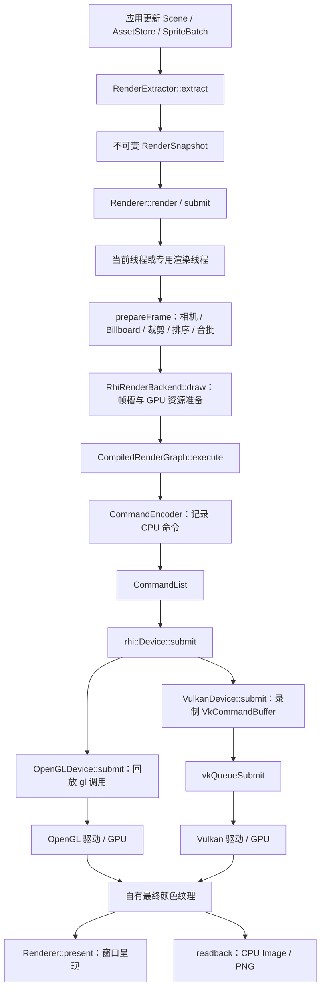
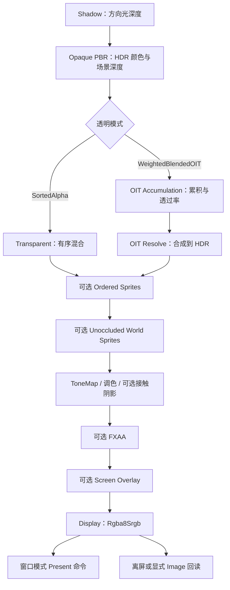
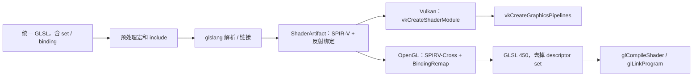
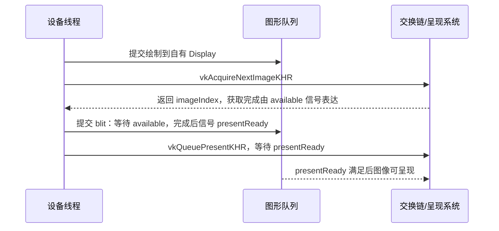

# 从 OpenGL 到 Vulkan：项目渲染封装与调用链

[文档导航](README.md) · [架构与生命周期](ARCHITECTURE.md) · [Vulkan 构建与运行](VULKAN.md) · [二次开发手册](DEVELOPMENT_GUIDE.md)

本文面向已经了解渲染流程、VBO/EBO、VAO、FBO、Shader 和 OpenGL 绘制调用，但尚未使用 Vulkan 的开发者。以 **0.2.0、2026-10-26 的源码**为依据，解释应用数据如何逐层变成 OpenGL/Vulkan 调用，以及两种后端为何可以共用前端。

阅读后的目标是：能够从 `Renderer::render()` 跟到一次原生 Draw，分清 CPU 录制、CPU 提交与 GPU 完成，找到纹理上传、描述符、屏障和窗口呈现的实现，并能在两种后端保存同一个场景的图片。本文解释当前项目实现；通用 Vulkan 概念在相关位置链接 Khronos 官方资料。标为“调用序列”或“示意”的代码省略了检查与结构体初始化，不能直接作为完整程序编译。

## 阅读顺序

第一次建议依次阅读第 1–6 节，建立项目封装的整体认识；随后阅读第 7–12 节，将 OpenGL 的经验映射到 Vulkan；最后沿第 13–18 节运行、调试和验证。只查 API 对应关系时，可直接阅读第 9 节的对照表和第 12 节的 Draw 跟踪。

本文不会重讲 MVP 变换、光栅化和 PBR 方程；重点是“谁准备数据、谁生成命令、谁调用 API、谁保证生命周期”。

## 1. 先建立整体调用图

应用选择图形后端时，主要改变窗口的 API 类型和渲染器工厂；场景、材质、相机、Sprite、文字和 UI 的上层数据继续使用统一接口。



这里有两层不同的后端边界：

| 边界 | 职责 | 实现位置 |
| --- | --- | --- |
| `detail::Backend` | 接收 `PreparedFrame`，组织帧槽、资产缓存、渲染图、呈现与回读 | `src/internal/backend.hpp`，共用实现是 `RhiRenderBackend` |
| `rhi::detail::DeviceBackend` | 创建 GPU 资源、回放命令、同步、设备能力与平台呈现 | `src/internal/rhi_backend.hpp`，具体实现为 `OpenGLDevice` / `VulkanDevice` |

`src/backends/opengl/renderer_backend.cpp` 和 `src/backends/vulkan/renderer_backend.cpp` 主要提供工厂。它们都把具体 `rhi::Device` 交给 `makeRenderBackend()`；真正的高层绘制管线在 `src/backends/common/renderer_backend.cpp` 中只实现一份。

**需要建立的认识：** 本项目的抽象对象不是一组 `gl*` 函数的同名包装。RHI 表达资源、管线、绑定、附件和命令等概念；两个后端分别负责将这些概念落实到各自 API。

## 2. 可运行的入口：同一个立方体输出两张图片

先用离屏程序验证高层接口的一致性。它不引入交换链，可以把注意力集中在场景、快照和纹理渲染上。Windows OpenGL 使用 WGL pbuffer，初始化存在短暂引导窗口；Vulkan 离屏完全不创建窗口、Surface 或 Swapchain。具体平台约束见[离屏文档](OFFSCREEN.md)。

将以下完整程序保存为外部工程的 `main.cpp`：

```cpp
#include <renderer/renderer.hpp>
#include <iostream>
#include <stdexcept>
#include <string_view>

int main(int argc, char **argv) {
    using namespace renderer;
    try {
        const std::string_view backend = argc > 1 ? argv[1] : "vulkan";
        if (backend != "opengl" && backend != "vulkan")
            throw std::invalid_argument("Expected opengl or vulkan");

        AssetStore assets;
        Scene scene;
        RenderExtractor extractor;
        const auto mesh = assets.createMesh(geometry::cube());
        const auto material = assets.createMaterial({
            .baseColor = {0.85f, 0.35f, 0.12f, 1},
            .metallic = 0.2f,
            .roughness = 0.4f,
        });
        const auto object = scene.createNode(scene.root(), "Cube");
        scene.setComponent(object, MeshRenderer{mesh, {material}});
        const auto camera = scene.createNode(scene.root(), "Camera");
        scene.setComponent(camera, Camera{});
        scene.setLocalTransform(camera, *Mat4::lookAt({3, 2, 5}, {0, 0, 0}).inverse());

        RendererConfig config;
        config.renderThread = true;
        // 教学程序只渲染一帧；0 表示不限新资源上传预算，确保首帧资源完整。
        config.assetUploadBudgetBytes = 0;
        const OffscreenConfig target{960, 640};
        auto engine = backend == "vulkan"
            ? Renderer::createVulkanOffscreen(target, config)
            : Renderer::createOpenGLOffscreen(target, config);

        RenderView view;
        view.cameraNode = camera;
        view.shadows = false;
        view.toneMapping = ToneMapping::ACES;
        view.antiAliasing = AntiAliasing::FXAA;
        const auto snapshot = extractor.extract(scene, assets);
        const auto image = engine.renderToImage(snapshot, view);
        image.savePng(backend == "vulkan" ? "cube-vulkan.png" : "cube-opengl.png");
        if (engine.debugErrorCount() != 0)
            throw std::runtime_error("Graphics debug errors were reported");
        std::cout << engine.deviceInfo().backend << ": " << image.width << "x"
                  << image.height << '\n';
        return 0;
    } catch (const std::exception &error) {
        std::cerr << error.what() << '\n';
        return 1;
    }
}
```

对应的完整 `CMakeLists.txt`：

```cmake
cmake_minimum_required(VERSION 3.25)
project(renderer_walkthrough LANGUAGES CXX)
find_package(renderer 0.2 CONFIG REQUIRED COMPONENTS core opengl vulkan)
add_executable(renderer_walkthrough main.cpp)
target_compile_features(renderer_walkthrough PRIVATE cxx_std_20)
target_link_libraries(renderer_walkthrough PRIVATE renderer::opengl renderer::vulkan)
if(MSVC)
    target_compile_options(renderer_walkthrough PRIVATE /utf-8)
endif()
```

此工程要求 SDK 同时安装两个后端；SDK 使用者的代码不需要包含 Vulkan/GLFW 头文件。先按 [SDK 文档](SDK.md)完成源码构建和安装，再从这个外部工程的目录执行：

```powershell
cmake -S . -B build -DCMAKE_PREFIX_PATH=C:/SDK/renderer
cmake --build build --config Release --parallel 6
.\build\Release\renderer_walkthrough.exe opengl
.\build\Release\renderer_walkthrough.exe vulkan
```

`renderToImage()` 在设备线程连续执行绘制和同步回读，返回的 `Image` 已可由 CPU 保存；离屏路径无需 `present()`。这里设置不限上传预算只为取得完整的单帧教学截图，正常资源流入场景可继续使用默认预算。

## 3. 前端封装：Scene、资产和快照分别保存什么

### 3.1 Scene 管理对象，AssetStore 管理共享数据

`Scene` 保存节点拓扑、局部变换及组件。`AssetStore` 保存不可变网格、纹理和材质。`MeshRenderer` 等组件用句柄引用资产，因此移动一个物体通常只修改节点变换，并不重新创建网格或纹理。

```cpp
// 局部片段：复用第 2 节中的 scene / object。
scene.setLocalTransform(object, Mat4::translation({1, 0, 0}));
```

这时没有调用 `glBufferSubData()` 或 `vkCmdCopyBuffer()`。变更先停留在 CPU 场景中，后续提取、帧准备和 GPU 上传才把它变为实例数据。

对外服务类使用 PImpl，例如 `Renderer` 持有 `Renderer::Impl`，内部实现再持有 `detail::Backend`。PImpl 用于隐藏实现依赖；后端选择通过内部虚接口和工厂完成。值类型、描述结构和内部辅助类不要求全部套用 PImpl。公共接口使用 C++ 标准库类型，项目未承诺跨编译器 ABI 兼容。

### 3.2 extract 生成供渲染使用的不可变数据

入口是 `src/renderer.cpp` 中的 `RenderExtractor::extract()`：

1. 更新派生世界变换与继承可见性；本地版本或父世界版本改变时才重新计算对应矩阵。
2. 遍历可见节点，解析 Mesh、Material、Sprite、Camera、Light 等数据。
3. 保留不可变资产引用，生成世界矩阵、法线矩阵、包围盒、精灵排序信息等渲染数据。
4. 缓存未改变的场景根，按条件复用或重拟合 BVH；额外传入的 `SpriteBatch` 作为共享不可变批次接入。
5. 发布 `RenderSnapshot`。

快照不等于命令列表，也不是 GPU 缓冲。它仍是 CPU 上的、与图形 API 无关的数据。场景提交后可以继续更新，新修改不会改变已经提交的快照。

应用线程仍须负责串行管理可变的 Scene/AssetStore；不可变快照并不意味着可以任意并发修改这些服务。

## 4. 高层提交：从 Renderer 到 PreparedFrame

`src/renderer.cpp` 中的实际关系是：

```text
Renderer::render(snapshot, view)
  -> Renderer::submit(snapshot, view).get()
       -> 在应用线程读取目标像素尺寸
       -> Renderer::Impl::enqueue(job)
            -> 在当前线程或专用渲染线程执行 job
                 -> detail::prepareFrame(snapshot, view, width, height)
                 -> backend->draw(preparedFrame, width, height)
```

`Renderer::Impl` 在 `src/internal/backend.hpp` 中管理任务队列。`renderThread=false` 时在调用线程直接执行；开启后，任务按顺序由一个专用线程执行。默认 `maxQueuedFrames=2`，队列满时提交者等待空位，避免快照和资产引用无限积压。

各入口的完成语义必须分清：

| 调用 | 返回时已经完成 | 返回时仍可能未完成 |
| --- | --- | --- |
| `submit(snapshot, view)` | 快照被接收；无渲染线程时也会直接执行任务 | 有渲染线程时可能尚未开始 CPU 帧准备；GPU 工作也可能未完成 |
| `submit(...).get()` / `render(...)` | 本次 CPU 帧准备、RHI 回放或 Vulkan 录制及相应提交 | GPU 绘制可能仍在执行 |
| `present()` | 执行窗口交换或提交呈现请求 | 不保证显示器已经扫描显示该帧，也不是通用 GPU 等待接口 |
| `readback()` / `renderToImage(...)` | 所需同步回读完成，CPU 图像可读 | 与本图像无关的后续工作不由此定义 |
| `waitIdle()` | 等待此前设备工作并处理回收 | 会阻塞，正常逐帧绘制无需每帧调用 |

`future` 表达的是 C++ 任务结果；它与 Vulkan 的 `VkFence` 不是同一个层面的同步对象。

## 5. prepareFrame：把场景变成可画的批次

实现入口：`src/frame_builder.cpp` 的 `detail::prepareFrame()`。

### 5.1 根据当前视图计算

它根据 `RenderView::cameraNode` 查找快照中的相机，计算视图/投影矩阵、灯光和阴影参数，按当前相机展开 Billboard，结合层掩码、视锥、BVH 和批次界限选择可见实例。相机 `aspectRatio=0` 时使用本次目标的宽高比。

阴影投影者需要额外考虑：视锥外的物体仍可能把影子投到视锥内。因此开启阴影时，项目不会简单地将所有视锥外投影者一起从候选中移除。

### 5.2 分类、排序和合批

| 队列 | 排序 / 合批策略 | 主要用途 |
| --- | --- | --- |
| 不透明及 Alpha Mask | 按材质、网格、submesh、镜像和深度状态聚类，相邻兼容项合批 | 深度测试与深度写入 |
| 常规排序透明 | 稳定排序，遵守精灵层、组、顺序及深度；只合并排序后相邻兼容项 | 保留 Alpha 层叠关系 |
| 加权 OIT 透明 | 按状态聚类合批，累积后再 Resolve | 近似处理多层透明 |
| `Ordered Sprites` | 在 OIT 模式下保留有序精灵和加色对象的顺序 | 需要美术层叠语义的物体 |
| 无深度世界精灵 | 保留排序，使用关闭深度测试的管线 | 无遮挡的世界名字牌等 |
| 阴影投影者 | 按状态聚类 | 当前仅不透明 / Mask 投影 |

`PreparedFrame` 包含 Frame Uniform、灯光、`InstanceGpu` 数组、各类 `DrawBatch`、覆盖层及统计数据。实例数据包含模型矩阵、法线矩阵、UV、颜色、纹理数组层和效果参数。一个批次可以对应多个实例，最终通过带实例数的索引绘制提交。

有序 Alpha 的合批受排序约束，不能跨过中间的透明物体任意重排。加权 OIT 是近似算法；项目仍有独立的有序队列，不能把开启 OIT 理解为所有精灵都失去顺序要求。详见 [OIT](OIT.md) 与 [Sprite](SPRITES.md)。

## 6. 共用高层后端：准备资源并执行渲染图

入口：`src/backends/common/renderer_backend.cpp` 中的 `RhiRenderBackend::draw()`。

主要步骤如下：

1. 选择当前目标对应的渲染图状态和下一个 `FrameSlot`。
2. 如果帧槽用过，等待该槽的 `CompletionToken`，随后才能安全修改它的实例、Uniform、灯光和覆盖层缓冲；同时读取这一个已完成旧帧的 GPU 时间戳。
3. 清理失去 CPU 所有者的缓存项；底层原生资源是否能立即销毁还取决于 GPU 完成状态。
4. 目标尺寸、阴影尺寸、透明/FXAA 模式或相关队列结构变化时重建图；其他帧复用编译图和物理资源。
5. 在上传批次内按预算准备网格、纹理、材质及覆盖层；新资源不完整的批次本帧跳过，在 `pendingResourceDraws` 中计数。
6. 更新帧 Uniform、灯光和实例数据。每个槽保存实例镜像，仅上传变化的连续范围。
7. 结束上传批次，调用 `graph->execute(device, slot.timestamps)`，将返回的完成标记保存到槽位。
8. 推进帧槽索引并返回统计；GPU 可以继续执行。

默认 `framesInFlight=3` 表示高层保留三个可轮转帧槽；不保证交换链也是三张图，也不等于 C++ 队列一定排着三帧。这些是三个独立概念。

### 6.1 当前渲染 Pass 的顺序



主要附件包括 `Depth32Float` 阴影图与场景深度、`Rgba16Float` HDR、`Rgba8Srgb` Display；OIT 另用 `Rgba32Float` 累积和 `R32Float` 透过率。

图中的可选节点可能不存在。关闭阴影时保留最小阴影目标/相应图结构用于共用绑定，实际投影批次为空；无深度世界精灵即使渲染作用域带有深度附件，所用管线的深度测试仍关闭。FXAA 的输入是 ToneMap 后手工编码的普通 RGBA8，UI 在 FXAA 后合成，因而不会被场景 FXAA 再过滤。

### 6.2 RenderGraph、原生渲染作用域和 Pipeline 的区别

| 名称 | 在项目中的含义 |
| --- | --- |
| 一个 RenderGraph Pass | 带资源访问声明和 CPU 回调的逻辑工作步骤 |
| `beginRendering` / `endRendering` | 命令列表中的附件渲染作用域，可包含多个 Draw |
| 一个 Graphics Pipeline | Shader、顶点布局、深度/光栅/混合和附件格式等状态的组合 |
| Vulkan 传统 `VkRenderPass` | Vulkan API 中的另一套原生对象；当前后端用动态渲染，不要求创建这种对象 |

当前 RenderGraph 的一次 `execute()` 会把所有存活 Pass 录入同一份 RHI 命令列表，再执行一次 `Device::submit()`。上传、资源初始化和窗口呈现可能产生额外提交，因此不能用“Pass 数量”推断 `vkQueueSubmit()` 次数。

## 7. RenderGraph 如何变成 RHI 命令

`src/render_graph.cpp` 中的 `RenderGraph::compile()` 主要完成：

1. 按声明检查缓冲字节范围、纹理 mip 范围的初始化和重叠访问，建立读后写、写后读、写后写依赖。
2. 从导出资源及副作用 Pass 反向保留依赖闭包，剔除无用 Pass。
3. 拓扑排序并检查依赖环。
4. 根据资源访问状态生成屏障计划，记录资源首末使用点。
5. 对描述相同、生命周期不重叠的临时资源复用同一物理资源。

这里的物理复用是逻辑资源共享已有 Buffer/Texture 对象；VMA 则在更下层为资源分配共享设备内存块中的范围，两者分别处理图内资源生命周期和设备内存布局。

`CompiledRenderGraph::execute()` 首次执行时解析/创建物理资源，以后复用；每帧仍会执行 Pass 回调并重新生成命令：

```text
解析 GraphResource -> RHI TextureHandle / BufferHandle
for 每个存活 Pass:
    录入该 Pass 所需的 ResourceBarrier
    录入开始时间戳
    执行 Pass 回调，向 CommandEncoder 写入绘制/计算命令
    录入结束时间戳
Device::submit(encoder.finish())
```

渲染图只能分析访问声明，不能自动推断回调里任意外部资源的使用。当前图也不自动把工作拆分到多个 Vulkan Queue。增加 Pass 时，应先把读写资源、范围和最终输出描述清楚，才能让两种后端得到一致的依赖计划。

## 8. Vulkan 新概念：用 OpenGL 经验建立对应关系

Vulkan 提供更显式的资源和执行控制，应用承担更多内存、状态与同步责任。它延续顶点、Shader、纹理、深度和混合等渲染概念。对已有 OpenGL 基础的开发者，主要新增工作集中在下表中的对象关系。[Khronos：What is Vulkan](https://docs.vulkan.org/guide/latest/what_is_vulkan.html)

| Vulkan 概念 | 作用 | 可以怎样联系 OpenGL 经验 |
| --- | --- | --- |
| 实例 `VkInstance` | 进入 Vulkan，管理实例扩展、校验及物理设备枚举 | OpenGL 没有一一对应的显式对象 |
| 物理设备 `VkPhysicalDevice` | 枚举出的 GPU 及其能力 | 选择 GPU/驱动能力这一层 |
| 逻辑设备 `VkDevice` | 创建资源和执行工作所需的设备接口 | 不能简单等同于“当前 GL Context” |
| 队列族 / 队列 `VkQueue` | 选择支持图形、计算、传输、呈现的执行入口 | 显式提交 GPU 工作的目的地 |
| 缓冲 / 图像 `VkBuffer` / `VkImage` | 定义资源形状和用途 | 对应 VBO/UBO/SSBO 和纹理存储的部分概念 |
| 设备内存 `VkDeviceMemory` | 资源实际绑定的存储 | 创建资源后还需要查询需求、分配并绑定内存 |
| 图像视图 `VkImageView` | 指定图像的格式、mip、层和访问方式 | 类似 Texture View，可共享底层存储 |
| 描述符集 `VkDescriptorSet` | Shader 使用的缓冲、图像、Sampler 等引用集合 | 类似一组 UBO/SSBO/Texture/Sampler 绑定 |
| 管线布局 `VkPipelineLayout` | 约定 Shader 可用的描述符集布局等接口 | 表达资源接口，不保存实际纹理像素 |
| 管线 `VkPipeline` | 组合 Shader 和大部分固定渲染状态 | 类似 Program + 顶点布局 + 深度/混合/光栅等状态 |
| 命令池 / 命令缓冲 | 分配并录制 GPU 命令 | 与项目 RHI 的 CPU 命令列表仍有一层转换 |
| Surface / Swapchain | 与窗口系统连接并管理可呈现图像 | 对应窗口默认帧缓冲背后的部分平台工作 |

一个 `VkQueue` 不应被当作“一条专用 CPU 线程”或“一条确定独占的 GPU 硬件通道”；它支持什么由队列族能力决定，硬件映射取决于实现。本项目选择支持图形和计算的通用队列，并在需要时选择单独的呈现队列；资源上传仍走该通用队列。[Khronos：Queues](https://docs.vulkan.org/guide/latest/queues.html)

## 9. RHI 到两种原生 API 的对应表

以下列出当前源码中的主要路径。创建和绑定通常涉及多个原生调用，表中只展示关键动作。

| 项目 RHI 操作 | OpenGL 后端 | Vulkan 后端 |
| --- | --- | --- |
| `createBuffer` | `glCreateBuffers`、`glNamedBufferStorage` | `vmaCreateBuffer`，内部创建资源并子分配/绑定内存 |
| `createTexture` | `glCreateTextures`、`glTextureStorage2D/3D` | `vmaCreateImage`、`vkCreateImageView`、初始化布局 |
| `createTextureView` | `glTextureView` | `vkCreateImageView`，保留父图像 |
| `createSampler` | 创建并配置 Sampler 对象 | `vkCreateSampler` |
| `createGraphicsPipeline` | SPIR-V 转 GLSL、编译链接 Program、创建 VAO、保存状态 | 创建 Shader Module、描述符布局、Pipeline Layout 和 `VkPipeline` |
| `createBindingGroup` | 保存逻辑绑定描述，Draw 前映射到 GL 绑定点 | 保存逻辑绑定描述，提交时按 Pipeline Layout 分配/更新描述符集 |
| `beginRendering` | 获取/缓存 FBO、绑定附件、清除并设置视口 | `vkCmdBeginRendering`，指定图像视图、Load/Store、Clear |
| `bindPipeline` | `glUseProgram`、VAO、深度/剔除/混合等状态 | `vkCmdBindPipeline`；视口和裁剪是动态状态 |
| `bindGroup` | Draw 前 `glBindBufferRange`、`glBindTextureUnit`、`glBindSampler` 等 | Draw 前 `vkUpdateDescriptorSets` / 缓存命中、`vkCmdBindDescriptorSets` |
| `bindVertexBuffer` / `bindIndexBuffer` | 暂存绑定描述，Draw 前配置 VAO | 暂存绑定描述，Draw 前 `vkCmdBindVertexBuffers` / `vkCmdBindIndexBuffer` |
| `drawIndexed` | `glDrawElementsInstancedBaseVertexBaseInstance` | `vkCmdDrawIndexed` |
| `dispatch` | `glDispatchCompute` | `vkCmdDispatch` |
| `copyBuffer` / `copyTexture` | GL 缓冲/图像拷贝接口 | `vkCmdCopyBuffer` / `vkCmdCopyImage` |
| `barrier` | 按访问用途组合 `glMemoryBarrier` 位 | `Vk*MemoryBarrier2` + `vkCmdPipelineBarrier2` |
| `timestamp` | `glQueryCounter` | `vkCmdWriteTimestamp2` |
| `submit` | 顺序回放原生 GL 调用，末尾插入 GL Sync 并 Flush | 创建/录制原生命令缓冲，`vkQueueSubmit` 关联 Fence |
| `wait` / `complete` | `glClientWaitSync` 等 | `vkWaitForFences` / `vkGetFenceStatus` |

对应源码为 `src/backends/opengl/rhi_device.cpp` 和 `src/backends/vulkan/rhi_device.cpp`。OpenGL 后端仍需要遵守映射内存、GPU 使用中资源及可见性要求；不能把“驱动处理较多隐式工作”理解为应用没有同步责任。

## 10. 初始化与资源上传：Vulkan 多出来的工作在哪里

### 10.1 初始化顺序

OpenGL 窗口路径的主要工作是创建 GLFW OpenGL 窗口/上下文、使上下文当前、通过 GLAD 加载函数、配置调试及 `glClipControl()`，再查询设备能力。

Vulkan 窗口创建使用 `GLFW_NO_API`，不创建 GL Context。随后 `initialize()` 大致执行：

```text
Volk 初始化 loader
  -> 查询实例扩展/校验层
  -> vkCreateInstance
  -> 加载实例函数表
  -> 可选 Debug Messenger
  -> 窗口模式 glfwCreateWindowSurface
  -> 枚举并筛选 VkPhysicalDevice
  -> 查询队列族、格式、内存及功能支持
  -> vkCreateDevice
  -> 加载设备函数表，vkGetDeviceQueue
  -> 创建 VMA 分配器、VkPipelineCache；提交命令池在首次需要时创建
```

当前筛选要求包括 Vulkan 1.3、`dynamicRendering`、`synchronization2`、独立附件混合以及可用时间戳；窗口模式还要求呈现和交换链支持。可选的 BC 压缩等能力根据设备查询结果启用。离屏路径跳过 Surface 和交换链扩展要求。

Vulkan 使用 Volk 的实例/设备函数表，如 `c->i.vkCreateDevice`、`c->f.vkCmdDrawIndexed`；这些成员调用仍是原生 Vulkan API。`Renderer::createVulkan()` 和 `Device::createVulkan()` 分别是高层和低层入口，通常选择其中一个管理同一窗口，不能同时占用同一个窗口。

### 10.2 Buffer：资源对象和存储分开

Vulkan `makeBuffer()` 调用 `vmaCreateBuffer()`，资源和底层内存仍是不同概念，但由分配器管理下面的内部步骤：

```text
vkCreateBuffer
vkGetBufferMemoryRequirements
根据 memoryTypeBits 和属性选择 memoryTypeIndex
从已有块子分配，或按需 vkAllocateMemory
vkBindBufferMemory / vkBindBufferMemory2
如果要求持久映射：由 VMA 取得映射并返回本分配起点
```

项目将 `Memory::Device` 映射为设备本地内存；`Memory::Upload` / `Readback` 使用主机可见且一致的内存并持久映射。主机一致（Host Coherent）省掉相应主机缓存 Flush/Invalidate 操作，但不允许在 GPU 读取时随意覆盖同一范围；执行和所有权仍需同步。[Khronos：Memory Property Flags](https://docs.vulkan.org/refpages/latest/refpages/source/VkMemoryPropertyFlagBits.html)

当前使用 VMA 3.4.0 子分配，优选大堆块大小为 32 MiB；大资源或驱动要求可使用专用分配。映射和共享块释放由 VMA 管理。上传暂存范围池与 VMA 的设备内存块是两层机制；当前没有自动显存整理。

### 10.3 纹理：Staging → Image

OpenGL 路径创建不可变纹理存储后，使用 `glTextureSubImage2D/3D` 或压缩纹理上传接口；区域更新走相应子图接口。

Vulkan 纹理路径先创建 `VkImage`、分配/绑定设备内存并创建视图，再通过暂存缓冲（Staging Buffer）传入像素：

```text
CPU 像素
  -> memcpy 到主机可见暂存缓冲
  -> 录制相关内存屏障
  -> vkCmdCopyBufferToImage
  -> 录制后续可见性依赖
  -> 提交后 GPU 执行复制
```

设备本地 Buffer 上传类似，复制命令为 `vkCmdCopyBuffer`；可映射 Buffer 可以直接写映射地址，但仍需等待旧用途完成。高层帧槽在复用前已经等待完成标记。

### 10.4 批量上传如何减少 CPU 等待

高层用 `UploadScope` 将同帧资源创建/初始化、像素上传、mip 生成、纹理复制等操作包进 `beginUploadBatch()` / `endUploadBatch()`。

Vulkan 的 `recordUpload()` 在批次内把工作写入 `pendingUploads`，批次结束统一提交并返回完成标记，通常不立即等待 GPU；后续绘制使用同一个通用队列，并由记录的内存依赖保证所需可见性。无批次的即时上传路径会提交并等待。首次创建图资源、同步回读及帧槽复用等路径仍可能阻塞。

当前暂存池从至少 1 MiB 的块中分配对齐范围；池总保留量上限 64 MiB，大于 8 MiB 的块不进入长期池。旧块只有在使用完成后才能从头复用；未完成的尾部空闲范围仍可分配给新上传。

这里“异步上传”表示 CPU 不为每个传输逐一等待，并不表示已经有独立 Transfer Queue 与 Graphics Queue 并行执行。

### 10.5 图像布局：当前项目的特殊策略

图像布局（Image Layout）描述图像子资源在某种用途下的布局状态，和图片文件格式、UV 或 RGBA/BGRA 不是同一概念。

当前 RHI 自有纹理创建后从 `UNDEFINED` 转到 `GENERAL`，随后采样、附件、复制等操作主要保持 `GENERAL`；资源屏障仍负责读写依赖。交换链图像单独处理，呈现复制时转为 `TRANSFER_DST_OPTIMAL`，完成后转为 `PRESENT_SRC_KHR`。

因此阅读常见教程中的“上传后转 `SHADER_READ_ONLY_OPTIMAL`”时，应区分教程策略与本项目策略。统一 `GENERAL` 简化了视图和绑定缓存的布局跟踪，但不保证所有用途都有最佳布局性能。布局转换本身也必须满足正确的依赖范围。[Khronos：Pipeline Barrier 2](https://docs.vulkan.org/refpages/latest/refpages/source/vkCmdPipelineBarrier2.html)

## 11. Shader、Pipeline 与资源绑定

### 11.1 一套 Shader 如何供两个后端使用

`src/shader.cpp` 的实际路径为：



反射（Reflection）从 SPIR-V 中取得资源名称、set/binding、类型、阶段和缓冲布局等信息，用于检查绑定接口。OpenGL 路径当前采用 SPIRV-Cross 转 GLSL 再编译链接，不依赖 OpenGL 原生直接加载 SPIR-V 的扩展。

编译器先处理 include/宏，再以处理后的内容建立缓存；高层也缓存不同材质效果和渲染状态对应的管线。首次出现新的 Shader/管线组合仍可能产生 CPU 开销。

### 11.2 set / binding 可以怎样理解

以下是用于解释接口的简化 GLSL 片段，不是内置完整 Shader：

```glsl
layout(std140, set = 1, binding = 0) uniform MaterialData {
    vec4 baseColor;
} material;
layout(set = 1, binding = 1) uniform sampler2D baseColorMap;
```

`set=1` 选择一组资源，`binding=0/1` 指定组内的接口位置；Uniform Buffer 和纹理/Sampler 的实际资源在运行时绑定。描述符保存资源访问描述，并不复制整张纹理像素。[Khronos：Mapping Data to Shaders](https://docs.vulkan.org/guide/latest/mapping_data_to_shaders.html)

内置管线主要约定：

| 逻辑组 | 典型内容 |
| --- | --- |
| 0：帧资源 | binding 0 Frame UBO、binding 1 Lights SSBO、binding 2 阴影纹理 |
| 1：材质资源 | binding 0 Material UBO、基色与其他 PBR 纹理 |
| 2：后处理资源 | HDR/深度、OIT 累积/透过率、FXAA 输入等，随具体 Shader 变化 |

实例矩阵等通过第二条顶点流及逐实例步进输入；“组号 1”不等于“顶点流 1”。`layout(location=...)`、顶点流 binding、描述符 set/binding 分别承担不同作用。

### 11.3 BindingGroup 在两个后端怎样落地

`createBindingGroup()` 只保存逻辑组号和资源条目。调用 `encoder.bindGroup()` 时也只记录句柄，实际资源应用通常延迟到 Draw/Dispatch 的准备阶段。

- OpenGL：合并 Shader 反射，分配各类物理绑定点，移除 GLSL 的 `set` 并重写 binding；Draw 前调用 `glBindBufferRange`、`glBindTextureUnit`、`glBindSampler` 或 `glBindImageTexture`。不能简单假设 OpenGL 物理 binding 永远等于逻辑 binding。
- Vulkan：根据合并后的 Shader 接口创建 `VkDescriptorSetLayout` 和 `VkPipelineLayout`；提交时从描述符池分配集合、检查类型/范围并写入，再调用 `vkCmdBindDescriptorSets`。相同管线/资源组合可以在本次提交中复用缓存；提交结束后仍保留相关资源到 Fence 完成。

描述符集布局是接口约定，描述符集是具体资源组合；`VkPipelineLayout` 也不等于“顶点输入布局”。

### 11.4 Vulkan Pipeline 包含什么

项目的 `GraphicsPipelineDesc` 描述 Shader、顶点属性/步进、颜色/深度附件格式、深度测试/写入/比较、剔除、绕序、偏移和混合等。

OpenGL 后端用 Program、VAO 和绘制时的状态调用实现这些语义；Vulkan 后端将大部分状态放进 `vkCreateGraphicsPipelines()`。当前 Vulkan 视口和裁剪为动态状态，绘制时通过 `vkCmdSetViewport` / `vkCmdSetScissor` 更新。

项目使用 Vulkan 1.3 动态渲染（Dynamic Rendering）：通过 `VkPipelineRenderingCreateInfo` 约定附件格式，在命令中使用 `vkCmdBeginRendering()` 传入具体附件。当前实现不走传统 `VkRenderPass` / `VkFramebuffer` 对象路径；动态渲染仍要求附件格式匹配和正确同步。[Khronos：vkCmdBeginRendering](https://docs.vulkan.org/refpages/latest/refpages/source/vkCmdBeginRendering.html)

## 12. 沿一次 drawIndexed 跟到原生调用

高层入口为共用后端的 `drawBatches()`。以下为保留关键参数的内部调用片段，变量来自当前批次和帧槽：

```cpp
encoder.bindPipeline(pipelineHandle);
encoder.bindGroup(frameGroup);
encoder.bindGroup(materialGroup);
encoder.bindVertexBuffer(0, meshVertices);
encoder.bindVertexBuffer(1, instanceBuffer);
encoder.bindIndexBuffer(meshIndices);
encoder.drawIndexed(indexCount, instanceCount, firstIndex, 0, firstInstance);
```

### 12.1 CPU 命令记录阶段

`src/rhi_commands.cpp` 的 `CommandEncoder` 把调用保存为 `std::vector<detail::Command>`，`Command` 是包含 Begin、Pipeline、Group、VertexBuffer、DrawIndexed 等载荷的 variant。`finish()` 将记录转移为不可变 `CommandList`。

此时没有执行 `glDrawElements*`，也没有调用 `vkCmdDrawIndexed`。记录阶段验证一些顺序和参数范围；完整设备句柄、附件和绑定兼容性还会在后端提交时检查。

CPU `CommandList` 持有句柄，不自动等价于“保留了所有原生 GPU 对象”。低层调用者应保证引用的资源至少在 `Device::submit()` 解析它们时仍有效；后端成功提交后会追踪原生资源的 GPU 使用。高层通过快照、GPU 缓存和提交记录组织这些生命周期。

### 12.2 OpenGL 提交阶段

`OpenGLDevice::submit()` 遍历 CPU 命令，回放为下列调用序列：

```text
beginRendering -> 获取/缓存并绑定 FBO，处理 Load/Clear，设置视口
bindPipeline   -> glUseProgram、glBindVertexArray、深度/剔除/混合状态
bindGroup      -> 暂存逻辑绑定
Draw 准备      -> 应用 UBO/SSBO/纹理/Sampler，配置实际顶点与索引缓冲
drawIndexed    -> glDrawElementsInstancedBaseVertexBaseInstance
endRendering   -> 结束附件作用域并处理 Store 语义
提交末尾       -> glFenceSync、glFlush，返回 CompletionToken
```

索引目前是 32 位无符号整数。OpenGL Draw 参数中的索引地址是 `索引缓冲绑定偏移 + firstIndex * 4`，`instanceCount` 和 `firstInstance` 分别控制实例数及实例起点。

`glFlush()` 让已记录的 GL 工作进入执行流程，返回并不代表 GPU 已绘制完成。后端把单调提交序号与 GL Sync 关联，用于完成查询、帧槽复用及延迟销毁。

### 12.3 Vulkan 提交阶段

`VulkanDevice::submit()` 先刷新待处理上传，再取得或创建本次 `Submission` 上下文。关键调用序列如下：

```text
首次需要：创建本上下文命令池、PRIMARY 命令缓冲和 Fence
复用完成上下文：vkResetCommandPool、vkResetFences、vkResetDescriptorPool
vkBeginCommandBuffer（ONE_TIME_SUBMIT）
  -> 回放 CPU CommandList
  -> vkCmdPipelineBarrier2
  -> vkCmdBeginRendering
  -> vkCmdBindPipeline
  -> 准备并绑定 Descriptor Sets
  -> vkCmdBindVertexBuffers / vkCmdBindIndexBuffer
  -> vkCmdDrawIndexed(indexCount, instanceCount, firstIndex, vertexOffset, firstInstance)
  -> vkCmdEndRendering
vkEndCommandBuffer
vkQueueSubmit(queue, ..., fence)
返回 CompletionToken
```

`vkCmd*` 大多是在 CPU 上向原生命令缓冲录制命令，GPU 在队列提交后执行。项目 RHI 先记录一层 CPU 命令，再由 Vulkan 后端录制一层 `VkCommandBuffer`；这两个列表不能混为一谈。

当前真实提交接口是 **`vkQueueSubmit`，不是 `vkQueueSubmit2`**；项目使用 synchronization2 的地方包括 `vkCmdPipelineBarrier2` 和 `vkCmdWriteTimestamp2`。提交成功后由 Fence 表达对应工作完成情况，不能仅凭 C++ 函数返回推断 GPU 完成。[Khronos：vkQueueSubmit](https://docs.vulkan.org/refpages/latest/refpages/source/vkQueueSubmit.html)

## 13. 同步：先区分四个层面

| 同步层面 | 解决什么问题 | 项目中的例子 |
| --- | --- | --- |
| CPU 任务同步 | 哪个线程什么时候执行任务 | mutex / condition_variable / packaged_task / future |
| GPU 内存依赖 | 写入结果何时可供后续用途读取 | RenderGraph Barrier、上传前后屏障、渲染作用域边界依赖 |
| GPU/呈现操作间等待 | 交换链图像可用及呈现前内容就绪 | Acquire Semaphore、Present Semaphore |
| CPU 等待 GPU | 什么时候能覆写映射内存、读回或释放提交资源 | `CompletionToken` → GL Sync / `VkFence` |

### 13.1 为什么命令按顺序提交还需要 Barrier

考虑“阴影 Pass 写深度图，PBR Pass 随后采样”。依赖不仅要求逻辑顺序，还需要让后续 Shader 访问看见前一用途写出的结果。Vulkan 屏障描述源/目标阶段、访问类型和资源范围；资源状态合法也不能代替内存依赖。

一个用于理解的依赖表达是：

```text
源用途：深度附件写入，阶段为早期/晚期片元测试
目标用途：片元 Shader 采样读取
资源范围：该阴影图相应子资源
```

RenderGraph 将这种信息编码为 `ResourceBarrier`，Vulkan 后端映射到 `VkImageMemoryBarrier2` / `VkBufferMemoryBarrier2` 等；当前还在部分边界使用较保守的全命令阶段内存依赖。OpenGL 后端映射到相应 `glMemoryBarrier` 位。当前代码的屏障策略可以继续收紧，阅读时应按实际实现判断范围。[Khronos：Synchronization](https://docs.vulkan.org/guide/latest/synchronization.html)

同一队列提供提交顺序相关保证，但一般资源读写依赖仍需正确同步；跨队列也不会天然有序。本项目暂未实现通用异步多队列调度。[Khronos：Queues](https://docs.vulkan.org/guide/latest/queues.html)

### 13.2 Fence 如何保护帧槽与资源

`CompletionToken` 包含设备身份和提交序号。Vulkan 的 `queue()` 将序号、原生命令缓冲、Fence、描述符池和使用到的资源保存在 `Submission` 中。

```text
第 N 次使用 FrameSlot 0
  -> 提交绘制，保存 token A
继续使用 FrameSlot 1、2
再次使用 FrameSlot 0
  -> device.wait(token A)
  -> 更新该槽 Uniform / Instances / Lights
  -> 提交新绘制，保存 token B
```

`collect()` 查询已完成提交，释放资产引用，并把命令池/缓冲、Fence 和描述符池送入有界缓存；复用前重置，超限或失败上下文才销毁。`wait(token)` 必要时调用 `vkWaitForFences()` 后再收集。Fence 是主机侧查询/等待 GPU 完成的工具，并不替代 GPU 资源读写所需的 Barrier。[Khronos：vkWaitForFences](https://docs.vulkan.org/refpages/latest/refpages/source/vkWaitForFences.html)

## 14. 窗口呈现：Present 命令与 present() 是两步

本项目始终先渲染到自有 Display 纹理。窗口模式的图末尾有一个名为 `Present` 的逻辑 Pass，它录入 `encoder.present(display)`；随后应用再调用 `Renderer::present()`。这两个名字相似，行为必须对照后端理解。

### 14.1 OpenGL 路径

```text
render()
  -> 渲染自有 FBO / Display 纹理
  -> 回放 Present 命令：glBlitFramebuffer 拷贝到窗口默认帧缓冲
present()
  -> 设备线程 glfwSwapBuffers
```

### 14.2 Vulkan 路径

```text
render()
  -> 渲染到自有 Display 图像
  -> Present 命令保存本次 presentSource，并保留其原生引用
  -> 提交场景绘制
present()
  -> VulkanDevice::swap()
  -> 必要时创建/重建交换链
  -> vkAcquireNextImageKHR，取得 imageIndex，并传入 available Semaphore
  -> 录制交换链图像布局转换及 Display -> Swapchain 的 blit
  -> 队列提交等待 available，完成后信号通知本图像的 Present Semaphore
  -> vkQueuePresentKHR 等待该 Semaphore，再交给呈现系统
```

取得图像索引不等于可以忽略获取完成同步；应用在真正使用图像的 GPU 工作中等待获取信号。[Khronos：vkAcquireNextImageKHR](https://docs.vulkan.org/refpages/latest/refpages/source/vkAcquireNextImageKHR.html)



交换链图像的布局变化是：

```text
第一次使用：UNDEFINED
后续使用：PRESENT_SRC_KHR
    -> TRANSFER_DST_OPTIMAL
    -> blit 写入
    -> PRESENT_SRC_KHR
```

项目按交换链图像持有呈现完成 Semaphore，避免仍被呈现系统等待时过早复用；获取用 Semaphore 跟随相关提交回收。呈现队列可以与图形队列不同，交换链在需要时使用对应共享模式。呈现是排队请求，不保证 `present()` 返回时显示器已显示该帧。[Khronos：vkQueuePresentKHR](https://docs.vulkan.org/refpages/latest/refpages/source/vkQueuePresentKHR.html)

窗口尺寸改变、`OUT_OF_DATE` 或相关 `SUBOPTIMAL` 路径会触发安全重建；当前重建可能等待设备空闲。最小化时零尺寸跳过相关工作。离屏路径没有交换链，不需要这一整套 Acquire/Present 流程。

## 15. 坐标、颜色与前端一致性

两种后端一致还需要统一以下约定，不能只把 Draw 换成不同函数：

| 项目约定 | 当前处理方式 |
| --- | --- |
| 右手坐标、NDC 深度 `[0,1]` | OpenGL 初始化设置 `glClipControl(GL_LOWER_LEFT, GL_ZERO_TO_ONE)`；共用投影数据 |
| 手工上传图像按左下行序 | Vulkan 保留 RHI 存储约定，光栅绕序在 Pipeline 创建时补偿 |
| 输出 `Image` 按左上行序 | 回读路径整理行序；Vulkan 呈现 blit 同时处理窗口方向 |
| 光照/HDR 使用线性颜色 | 基色 sRGB 采样、HDR 运算、ToneMap 和最终编码按共用管线组织 |
| FXAA 处理 ToneMap 后编码值 | 单独的普通 RGBA8 输入避免被 sRGB 采样额外解码 |
| UI 覆盖层 | ToneMap/FXAA 后按线性预乘 Alpha 合成 |

不能把上传纹理的行序直接当作 `Image::pixels` 的行序，也不应在应用层因切换 Vulkan 随意再翻 UV、改投影深度或手工做第二次 Gamma 编码。需要调整这些约定时，应同时检查 Shader、RHI、读回、拾取和呈现。

项目有同一快照的双后端像素对比检查；特定测试通过不代表不同 GPU/驱动上的所有浮点渲染都逐字节相等。实测平台及范围见[验证记录](VALIDATION.md)。

## 16. 线程与生命周期：哪些工作真的并行了

默认不开独立渲染线程。开启后，应用线程负责事件、可变场景更新及快照提取；渲染线程负责 `prepareFrame()`、GPU 缓存/上传、渲染图执行、设备操作及呈现。资源解码、地图读取、物理任务与音频各有自己的执行约定，不由渲染器自动调度。

OpenGL Context 同一时刻只交给一个线程。启动时应用线程解绑，工作线程接管；销毁时排空队列，并在拥有上下文的线程清理 GPU 对象。窗口和 GLFW 事件仍留在窗口创建线程。

Vulkan 没有 GL 的 Current Context，但当前引擎仍对 Device 实行相同的单设备线程归属检查；`releaseContext()` / `acquireContext()` 在此主要表达引擎操作权转移。Vulkan 可以设计成多线程录制，但本项目当前没有并行录制多个原生 `VkCommandBuffer` 的任务系统。共享 Queue、Command Pool 等对象也有外部同步要求。[Khronos：Queues](https://docs.vulkan.org/guide/latest/queues.html)

生命周期可以按以下三层观察：

1. **CPU 资产层**：Scene 引用资产句柄，快照保留不可变资源，旧快照可以继续使用旧版本。
2. **RHI 句柄层**：owner/index/generation 区分设备和代际，destroy 后该句柄立即失效。
3. **原生 GPU 层**：已提交工作保留或追踪原生对象，GPU 完成后才能回收；旧纹理视图还会保留父存储。

所以“资产从仓库移除”“句柄不能再用”“显存真正释放”可能发生在不同时间。缓存、未完成帧和暂存池也会影响内存统计；不要把资源有效载荷估算直接当成驱动显存占用。

## 17. 按源码调试：推荐的断点与验证路线

### 17.1 源码入口表

SDK 安装包不包含私有实现源码；安装后的读者应保留与 SDK 同一次构建的[工程源码](https://github.com/LiuTag/renderer)，按下列路径和函数名检索。后续修改可能使行号变化。

| 阅读目标 | 路径与检索符号 |
| --- | --- |
| 场景提取 | `src/renderer.cpp`：`RenderExtractor::extract` |
| 高层提交语义 | `src/renderer.cpp`：`Renderer::render`、`submit`、`renderToImage`、`present` |
| 任务队列/上下文移交 | `src/internal/backend.hpp`：`Renderer::Impl::start`、`enqueue` |
| 帧准备/合批 | `src/frame_builder.cpp`：`prepareFrame`、局部 `append` |
| 高层共用管线 | `src/backends/common/renderer_backend.cpp`：`draw`、`buildGraph`、`drawBatches` |
| 图编译/执行 | `src/render_graph.cpp`：`RenderGraph::compile`、`CompiledRenderGraph::execute` |
| CPU 命令载荷 | `src/internal/rhi_commands.hpp`、`src/rhi_commands.cpp`：`CommandEncoder` |
| RHI 转发/后端边界 | `src/rhi.cpp`、`src/internal/rhi_backend.hpp`：`Device::submit`、`DeviceBackend` |
| 统一 Shader | `src/shader.cpp`：`compile`、`toOpenGL`；`src/backends/common/portable_shaders.hpp` |
| GL 资源/执行 | `src/backends/opengl/rhi_device.cpp`：`createBuffer`、`createGraphicsPipeline`、`submit`、`swap` |
| VK 初始化/上传 | `src/backends/vulkan/rhi_device.cpp`：`initialize`、`makeBuffer`、`createTexture`、`recordUpload` |
| VK 绑定/执行/回收 | 同上：`pipelineLayout`、`submit`、`begin`、`queue`、`collect`、`wait` |
| VK 窗口呈现 | 同上：`createSwapchain`、`swap` |

第一次只给 `drawIndexed()` 设置断点会看到 CPU 命令记录。继续跟到 `OpenGLDevice::submit()` / `VulkanDevice::submit()` 中对 `detail::DrawIndexed` 的处理，才会看到原生 Draw。再跟 Vulkan `queue()` 才能看到真正的队列提交。

### 17.2 用现有示例观察窗口流程

以下命令从源码根目录执行，需要对应 SDK、驱动和构建工具；配置会改变 `build/windows` 的开关，可按自己的构建目录调整：

```powershell
cmake --preset windows -DRENDERER_BUILD_OPENGL=ON -DRENDERER_BUILD_VULKAN=ON -DRENDERER_BUILD_EXAMPLES=ON -DRENDERER_BUILD_TESTS=ON -DRENDERER_GL_TESTS=ON -DRENDERER_VULKAN_TESTS=ON
cmake --build build/windows --config Debug --target renderer_demo renderer_vulkan_demo --parallel 6
.\build\windows\Debug\renderer_demo.exe --threaded --oit --fxaa
.\build\windows\Debug\renderer_vulkan_demo.exe --threaded --oit --fxaa
```

首次可先省略 `--threaded`，方便单线程跟栈；之后再观察上下文/设备操作权移交。`debug=true` 时，Vulkan 在校验层可用时启用它，调试信息写入 stderr；未安装校验层时零错误计数不能证明已经运行过校验层。

### 17.3 验证理解的五个小任务

| 任务 | 观察点与判断标准 |
| --- | --- |
| 分别运行第 2 节的两种后端 | 输出两张同尺寸 PNG，能看到相同相机下的橙色立方体，调试错误计数为 0 |
| 修改节点变换后重新提取 | 新快照显示新位置；回放旧快照仍保留旧位置；网格/纹理继续复用 |
| 跟踪 `CommandEncoder::drawIndexed` 到原生 Draw | 能解释 CPU 命令列表、Vulkan 命令缓冲、Queue Submit 的三层差异 |
| 打开/关闭 OIT 和 FXAA | 观察 `buildGraph` 与 Pass 列表变化；理解透明累积/Resolve 及 UI 所处阶段 |
| 窗口缩放并观察 Vulkan `swap` | 能找到交换链范围变化、Acquire、布局转换、Semaphore 和重建路径 |

针对当前实现的既有回归入口：

```powershell
ctest --test-dir build/windows -C Debug -R "^renderer\.(opengl|vulkan)\.(offscreen|texture|upgrade)$|^renderer\.vulkan\.parity$" --output-on-failure
```

执行前需已经构建这些测试目标，并确认 CTest 输出实际包含目标检查。API 适配和图像语义看测试，性能观察使用[性能矩阵](../examples/performance/README.md)；同步回读、垂直同步和验证层会改变时间，比较时应固定条件。

## 18. 扩展时先改哪一层

| 想增加的能力 | 优先修改的位置 | 需要继续检查的下层 |
| --- | --- | --- |
| 新 Sprite 属性或场景组件 | 公共描述、Scene/资产、快照和 `prepareFrame` | 实例布局、合批键、Shader、拾取/裁剪 |
| 新材质效果 | 公共材质效果接口及共用 Shader | 反射、Pipeline 缓存、阴影/透明组合 |
| 新后处理 | 共用高层 `buildGraph`，声明输入/输出/访问 | Pipeline、BindingGroup、两后端附件和屏障 |
| 新 RHI 操作或资源类型 | 公共 RHI、CPU 命令载荷、`DeviceBackend` | OpenGL/Vulkan 两套实现、能力查询与测试 |
| 上传优化 | 共用资源准备、Vulkan 暂存和上传批次 | 预算、顺序/可见性、旧版本保留和统计 |
| 新窗口呈现方式 | 平台窗口与具体 RHI 的 `swap` | Swapchain / GL Context、缩放、线程和颜色约定 |

当前 Vulkan 已有提交上下文复用和 VMA 子分配；后续边界包括统一 `GENERAL` 布局、保守屏障、单设备线程及通用队列上传。并行原生命令录制、独立异步传输队列、自动显存整理和 Bindless 尚未实现。附件为单采样，现有抗锯齿是 FXAA；不能据此推断已经支持 MSAA。图形/计算 RHI 可用，也不代表已经实现异步 Compute 调度。

修改以上边界时，前端契约、资源生命周期和测试应一并调整。更完整的功能边界见 [Vulkan 文档](VULKAN.md) 和[实现清单](../IMPLEMENTATION.md)。

## 19. 本文资料依据与后续查阅

项目事实来自本文所列的当前源码入口；下列官方资料于 **2026-10-26** 实际查阅，用于解释 API 概念。它们解释 Vulkan 规范语义，项目是否使用某项能力仍以源码为准。

| 资料 | 用途与阅读阶段 |
| --- | --- |
| [Khronos：What is Vulkan](https://docs.vulkan.org/guide/latest/what_is_vulkan.html) | 入门；理解显式 API 的责任划分 |
| [Khronos：Queues](https://docs.vulkan.org/guide/latest/queues.html) | 入门到进阶；区分队列、队列族、CPU 线程和硬件执行 |
| [Khronos：Mapping Data to Shaders](https://docs.vulkan.org/guide/latest/mapping_data_to_shaders.html) | 结合 Shader 阅读；理解顶点属性、描述符及 set/binding |
| [Khronos：Memory Property Flags](https://docs.vulkan.org/refpages/latest/refpages/source/VkMemoryPropertyFlagBits.html) | 查阅；区分设备本地、主机可见及主机一致 |
| [Khronos：Synchronization](https://docs.vulkan.org/guide/latest/synchronization.html) | 进阶；建立执行、可见性和等待的区分 |
| [vkCmdPipelineBarrier2](https://docs.vulkan.org/refpages/latest/refpages/source/vkCmdPipelineBarrier2.html) / [vkCmdBeginRendering](https://docs.vulkan.org/refpages/latest/refpages/source/vkCmdBeginRendering.html) | 结合后端阅读；了解当前两项 Vulkan 1.3 核心调用 |
| [vkQueueSubmit](https://docs.vulkan.org/refpages/latest/refpages/source/vkQueueSubmit.html) / [vkWaitForFences](https://docs.vulkan.org/refpages/latest/refpages/source/vkWaitForFences.html) | 查阅；理解提交返回与 GPU 完成的区别 |
| [vkAcquireNextImageKHR](https://docs.vulkan.org/refpages/latest/refpages/source/vkAcquireNextImageKHR.html) / [vkQueuePresentKHR](https://docs.vulkan.org/refpages/latest/refpages/source/vkQueuePresentKHR.html) | 结合窗口模式阅读；理解获取与呈现的同步 |

当前学习状态：已知先修为渲染与 OpenGL 基础；本文件提供项目源码导读和可运行入口，尚未根据你的操作结果确认 Vulkan 实践掌握程度。下一步可完成第 17.3 节任务，先能独立讲清“一次 Draw 的三层命令”，再继续拆解具体资源和同步代码。
